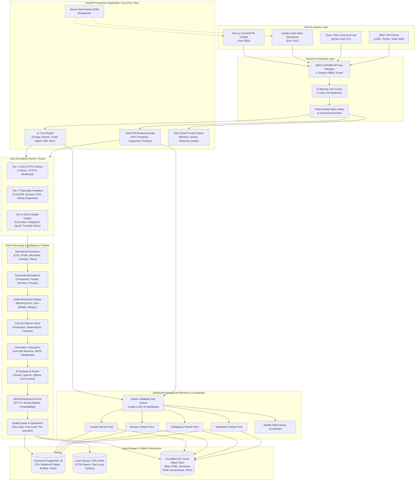

# GrowX Crawl & AutoGTM Platform
# Master Architecture, Technology Stack, File Tree & Features Specification

**Platform Name:** GrowX Crawl (`growx-crawl`) & AutoGTM Platform  
**Document Version:** 2.0.0-ENTERPRISE  
**Date:** October 2026  
**Engineering Team:** GrowX Labs Core Engineering (`engineering@growxlabs.tech`)  
**Repository Path:** `c:\growxlabs\growx-crawl`  

---

## Table of Contents
1. [Executive Summary & Core Philosophy](#1-executive-summary--core-philosophy)
2. [End-to-End System Architecture](#2-end-to-end-system-architecture)
   - [2.1 High-Level Architectural Flowchart](#21-high-level-architectural-flowchart)
   - [2.2 Detailed Subsystem Breakdown](#22-detailed-subsystem-breakdown)
3. [Comprehensive Technology Stack & Specifications](#3-comprehensive-technology-stack--specifications)
4. [Complete Repository File Tree & Component Directory](#4-complete-repository-file-tree--component-directory)
   - [4.1 Root & Environment Configuration](#41-root--environment-configuration)
   - [4.2 Configuration Subsystem (`config/`)](#42-configuration-subsystem-config)
   - [4.3 Deployment & Infrastructure (`deploy/`)](#43-deployment--infrastructure-deploy)
   - [4.4 Operational Runbooks & Blueprints (`docs/`)](#44-operational-runbooks--blueprints-docs)
   - [4.5 Next.js 14 Frontend Application (`frontend/`)](#45-nextjs-14-frontend-application-frontend)
   - [4.6 Automation & Maintenance Scripts (`scripts/`)](#46-automation--maintenance-scripts-scripts)
   - [4.7 Core Source Code Engine (`src/growx_crawl/`)](#47-core-source-code-engine-srcgrowx_crawl)
   - [4.8 Automated Verification Test Suite (`tests/`)](#48-automated-verification-test-suite-tests)
   - [4.9 Data & Export Artifacts (`data/`, `exports/`, `storage/`)](#49-data--export-artifacts-data-exports-storage)
5. [Exhaustive Platform Features & Capabilities Catalog](#5-exhaustive-platform-features--capabilities-catalog)
6. [Enterprise Scaling & Production Deployment Topologies](#6-enterprise-scaling--production-deployment-topologies)

---

## 1. Executive Summary & Core Philosophy

**GrowX Crawl** is an enterprise-grade **Autonomous Web Intelligence, Identity Resolution, and Go-To-Market (AutoGTM) Engine**. Architected as a high-margin **SWAS (Software-with-a-Service)** platform, it is purpose-built to solve the fundamental breakdown of legacy B2B intelligence databases (e.g., Apollo, ZoomInfo, Cognism, Explee).

### Why Traditional B2B Databases Fail
* **Data Decay:** Legacy databases store static snapshots that decay at 3%–5% per month, resulting in 30%–40% stale records, broken websites, defunct companies, and departed executives within a year.
* **Severe Email Deliverability Penalties:** Outdated contact databases result in hard bounce rates exceeding 10%–15%, burning corporate domain reputation and triggering email provider spam blocks.
* **Generic, Uninformed Outreach:** Outdated contact lists force salespeople to send generic, templated messages that prospects ignore.

### The GrowX Crawl Paradigm: "Live Web Truth"
GrowX Crawl rejects cached databases in favor of real-time web extraction:
1. **Live Ground Truth:** Prospects and companies are discovered and evaluated in real time from their active digital footprint (live websites, sitemaps, pricing pages, executive team directories, job postings, and press releases).
2. **Deterministic Evidence Citation:** Every attribute (tech stack, executive name, corporate address, pricing tier, hiring signal) is linked to a permanent observation record containing the exact URL source, extraction timestamp, and raw HTML evidence snippet. Zero hallucinated claims.
3. **Auto-Escalating Scraping Cluster:** A 3-tier fetcher dynamically escalates from ultra-fast HTTP requests (~100ms) to dynamic headless browsers (Playwright) and specialized anti-detection engines (Camoufox / Ghost) to bypass Cloudflare Turnstile, perimeter WAFs, and dynamic bot challenges.
4. **Zero-Cost Identity & Deliverability Verification:** Integrated DNS-over-HTTPS (DoH) MX routing and socket-level SMTP handshake deliverability testing verify email validity without external API subscription fees (e.g., ZeroBounce, NeverBounce).
5. **Autonomous Closed-Loop AutoGTM:** An end-to-end pipeline analyzes client websites, synthesizes Ideal Customer Profiles (ICPs), discovers matching accounts, harvests verified decision-makers, and crafts high-converting, multi-channel sales sequences (Email, LinkedIn, Twitter/X) grounded in crawled facts.

---

## 2. End-to-End System Architecture

### 2.1 High-Level Architectural Flowchart



### 2.2 Detailed Subsystem Breakdown

#### 1. Client & Ingress Security Layer
* **Role-Based Access Control (RBAC):** Supports tiered API key authentication (`Authorization: Bearer gx_live_...` or `x-api-key`) and session-based operator authentication restricted to admin operators.
* **Cryptographic Verification:** API keys are hashed with HMAC-SHA256 and matched using constant-time string comparisons (`secrets.compare_digest`).
* **Multi-Tier Rate Limiting & Quotas:** Tier-based throttling (Starter: 60 RPM / 10k monthly; Growth: 300 RPM / 100k monthly; Enterprise: 1,200 RPM / Unlimited).
* **In-Memory LRU Cache:** Sub-millisecond in-memory cache with configurable TTL (default: 3,600s) to eliminate redundant external requests for recently scraped targets.

#### 2. Auto-Escalating Fetcher Cluster
* **Tier 1 (Fast HTTPX):** Uses asynchronous HTTP/1.1 and HTTP/2 clients with keep-alive connection pooling, compression negotiation (`brotli`, `zstandard`, `gzip`), and custom header rotation. Serves static websites in under 100ms.
* **Tier 2 (Headless Chromium via Playwright):** Automatically engaged when static HTML indicates client-side rendering (React, Angular, Vue, Next.js hydration). Executes JavaScript, waits for network idle and font rendering (`document.fonts.ready`), and captures full rendered DOM.
* **Tier 3 (Ghost Stealth & Evasion):** Activated on Cloudflare, Akamai, or perimeter WAF challenge detection. Employs Camoufox (custom stealth browser engine) with WebGL/Canvas spoofing, AudioContext fingerprint randomization, WebRTC IP leakage mitigation, humanized mouse movement trajectories, and Cloudflare Turnstile token resolution.

#### 3. Content Extraction & Semantic Classification
* **CSS & XPath Engine:** Arbitrary selector resolution with attribute querying (`@href`, `@src`, `@content`), inner text cleaning, and collection extraction.
* **Snapshot Preservation:** Injects `<base href="{url}">` tags into stored HTML snapshots to ensure full offline preview fidelity with styles, images, and fonts intact.
* **Semantic Page Classifier:** Heuristic and URL pattern classifier that identifies page archetypes (`homepage`, `about`, `team`, `pricing`, `contact`, `products`, `careers`, `legal`).

#### 4. Entity Resolution & Canonical Identity
* **Normalized Data Model:** Separates companies, domains, brand aliases, physical locations, executive personas, and employment records.
* **Blocking Keys & Clustering:** Deterministic blocking keys (e.g., phonetic Soundex, Metaphone, character n-grams) group candidate entity pairs for comparison.
* **Probabilistic Match Scoring:** Jaro-Winkler string similarity, domain registrable token matching, and executive name alignment compute merge confidence scores. Entities merge automatically when confidence $\ge 0.92$; lower scores are routed to manual review queues.

#### 5. Fact & Evidence Intelligence Subsystem
* **Predicate-Based Architecture:** Stores facts as triple-like structures `(Subject, Predicate, Value)` (e.g., `(Company_A, has_tech_stack, Stripe)`, `(Person_B, has_job_title, VP Engineering)`).
* **Verifiable Evidence Chain:** Every fact is linked to an `evidence` record capturing the raw HTML snippet, HTTP status, extraction rule, and timestamp.
* **Conflict Detection & Temporal Tracking:** Automatically identifies conflicting facts (e.g., multiple company sizes, changing leadership), resolves conflicts via source confidence hierarchies, and preserves historical timeline progressions.

#### 6. AI Gateway & Cost Orchestration
* **Multi-Model Routing:** Routes LLM tasks across Google Gemini (e.g., Gemini 1.5 Pro, Gemini 1.5 Flash), OpenAI (GPT-4o, GPT-4o-mini), OpenRouter, and local Ollama instances based on task complexity.
* **Resilience Patterns:** Incorporates circuit breakers, exponential backoff retries, and automated fallback chains (Primary Provider &rarr; Secondary Provider &rarr; Local Mock).
* **Strict Structured Outputs:** Enforces schema validation through Pydantic models.
* **Telemetry & Cost Accounting:** Tracks prompt tokens, completion tokens, latency, and estimated USD cost per task and project in real time.

#### 7. Zero-Cost Verification Subsystem
* **DoH MX Resolution:** Queries Google DNS (`8.8.8.8`) and Cloudflare DNS (`1.1.1.1`) over HTTPS (port 443), eliminating corporate UDP port 53 firewall restrictions.
* **Socket-Level SMTP Handshake:** Opens asynchronous direct socket connections to the recipient's mail exchanger (`HELO` &rarr; `MAIL FROM` &rarr; `RCPT TO`), detecting deliverability, invalid mailboxes, and catch-all domain configurations without sending email.
* **Freshness & Employment Verification:** Checks domain alive status, SSL certificate validity, and employment currency.

#### 8. Lead Qualification, ICP Fit & Prospect Ranking
* **Weighted Scoring Algorithm:** Computes composite scores (0–100) based on:
  - **ICP Fit Score (0–35 pts):** Industry match, company size, revenue signals, target geography.
  - **Data Confidence Score (0–25 pts):** Volume of verified facts, validated email, direct phone, LinkedIn profile.
  - **Buying Signal Score (0–25 pts):** Active hiring signals, recent tech stack migrations, new funding, product launches.
  - **Freshness & Timing Score (0–15 pts):** Recency of crawled observations and active website updates.
* **Ranking Profiles & Decision Tiers:** Categorizes prospects into Tier 1 (C-Suite/Founders), Tier 2 (VPs/Directors), and Tier 3 (Managers).

#### 9. Dual Storage Architecture
* **PostgreSQL 16 (Canonical Structured Truth):** 76+ relational tables with foreign keys, indexes, JSONB metadata, and transaction safety.
* **SQLite 3 WAL Mode (Local Fast Engine):** Single-file zero-configuration database with Write-Ahead Logging for concurrent reads, powering FTS5 BM25 search.
* **Object Store (Cloudflare R2 / Local FS):** Stores raw crawled HTML, rendered DOM snapshots, full-page PNG/JPEG screenshots, and generated PDF documents indexed by SHA-256 content hashes.

#### 10. Distributed Background Workers & Persistent Queue
* **Atomic Job Queue:** Queue table with atomic lease claiming (`FOR UPDATE SKIP LOCKED` / atomic state transactions) and periodic worker heartbeats.
* **Specialized Worker Roles:** Separate worker processes for HTTP crawling, browser automation, intelligence scoring, email verification, and nightly data consolidation.
* **Self-Healing Supervisor:** Dead worker reaper reclaims expired job leases automatically if a worker container crashes or restarts.

---

## 3. Comprehensive Technology Stack & Specifications

| Layer / Subsystem | Technology | Version | Purpose & Architectural Rationale |
| :--- | :--- | :--- | :--- |
| **Backend Language** | **Python** | 3.12 / 3.14 (64-bit) | Modern typing, high-performance async/await event loops, sub-interpreter optimizations. |
| **API Framework** | **FastAPI** | $\ge 0.110.0$ | High-speed ASGI REST API, automatic OpenAPI/Swagger documentation, Pydantic dependency injection. |
| **ASGI Server** | **Uvicorn** | $\ge 0.28.0$ | Production-grade lightning-fast asynchronous ASGI web server implementation. |
| **Data Validation** | **Pydantic & Pydantic-Settings** | $\ge 2.6.0$ | Robust runtime data parsing, schema enforcement, environment variable loading. |
| **Frontend Framework** | **Next.js (App Router)** | 14.2.15 | Production React 18 frontend with server-side rendering, routing, and Swiss minimalist UI. |
| **Frontend Language** | **TypeScript** | $\ge 5.6.3$ | Type-safe client development, shared DTO interfaces, error-free API client generation. |
| **Styling & Icons** | **Tailwind CSS & Lucide-React** | 3.4.14 / 0.453 | Utility-first responsive dark-mode styling, clean iconography, zero runtime CSS overhead. |
| **HTTP Client** | **HTTPX** | $\ge 0.27.0$ | Asynchronous HTTP/1.1 & HTTP/2 client with connection pooling, timeouts, and proxy support. |
| **Browser Engine** | **Playwright** | $\ge 1.44.0$ | Headless Chromium automation, dynamic DOM extraction, full-page screenshots, print PDFs. |
| **Stealth Engine** | **Camoufox & curl_cffi** | $\ge 0.5.0$ / $\ge 0.7.0$ | Anti-fingerprinting Firefox C++ fork and TLS fingerprint impersonator for WAF/Cloudflare bypass. |
| **HTML Parsing** | **BeautifulSoup4 & lxml** | $\ge 4.12.0$ / $\ge 5.1.0$ | High-performance C-accelerated DOM and XML parsing for structured data harvesting. |
| **Primary Database** | **PostgreSQL (Supabase/Docker)**| 16-alpine | Enterprise relational storage, 76+ canonical tables, JSONB query capabilities, ACID safety. |
| **Embedded Database**| **SQLite 3 (WAL Mode)** | 3.x | Zero-config embedded database, WAL mode for concurrency, FTS5 full-text indexing with BM25. |
| **Object Storage** | **Cloudflare R2 / Local FS** | S3 API compatible | Low-cost storage for snapshots, screenshots, and PDFs with SHA-256 deduplication. |
| **AI / LLM Gateway** | **Google Gemini & OpenAI** | Gemini 1.5 Pro / GPT-4o | Autonomous website offer analysis, buyer persona synthesis, and personalized outreach generation. |
| **Compression** | **Brotli & Zstandard** | $\ge 1.1.0$ / $\ge 0.23.0$ | High-efficiency payload decompression for fast HTTP web crawling. |
| **CLI Framework** | **Typer & Rich** | $\ge 0.12.0$ / $\ge 13.7.0$ | Developer-friendly CLI commands with colored console tables, progress bars, and diagnostics. |
| **Export Engines** | **openpyxl & csv** | $\ge 3.1.2$ | Multi-tab executive Excel `.xlsx` generation with custom cell styling, headers, and formulas. |
| **Networking & DNS** | **DNS-over-HTTPS (DoH)** | RFC 8484 | Cloudflare (1.1.1.1) and Google (8.8.8.8) DoH resolvers to bypass corporate port 53 blocking. |
| **Containerization** | **Docker & Docker Compose** | $\ge 24.0$ | Multi-container deployment (API, Next.js UI, PostgreSQL, 5 dedicated worker processes). |
| **Testing Framework**| **Pytest & Pytest-Asyncio** | $\ge 8.0.0$ / $\ge 0.23.0$ | Automated test runner with asynchronous fixtures, contract tests, and unit coverage. |

---

## 4. Complete Repository File Tree & Component Directory

Below is the complete inventory of every file and directory across the repository, along with an explanation of its role in the system:

```text
c:\growxlabs\growx-crawl\
├── .env.example                               # Production environment variable template
├── .gitignore                                 # Git ignore rules (DBs, caches, local configs, exports)
├── ARCHITECTURE_AND_STACK_REPORT.md           # Master System Architecture & Technology Stack Report
├── growx-crawl.bat / .cmd                     # Windows batch launch scripts for local CLI execution
├── growx_canonical.db                         # Local SQLite canonical database store
├── growx_crawl.db                             # Primary local SQLite database with FTS5 search tables
├── lightpanda                                 # Experimental ultra-fast C++ headless browser binary
├── payload.json                               # Sample JSON payload for API testing and CRM verification
├── pyproject.toml                             # Python package definition, dependencies, hatchling config
├── README.md                                  # Developer documentation, API endpoints, quickstart guide
├── sample-seeds.csv                           # Sample seed file for testing lead discovery and batching
├── targets_full_summary.txt                   # Diagnostic log of crawled healthcare targets
├── targets_list.txt                           # Text list of target domains for batch runs
├── test_leads.xlsx                            # Sample exported Excel deliverable for testing
│
├── config/                                    # System Configuration Presets & YAML Policies
│   ├── ai/
│   │   ├── budgets.yaml                       # Maximum daily and monthly token/spend limits per model
│   │   ├── models.yaml                        # Supported LLM model catalog (Gemini, OpenAI, Ollama)
│   │   ├── routing.yaml                       # Task-to-model routing configuration
│   │   └── tasks.yaml                         # Prompt templates and parameter configs for AI jobs
│   ├── data_factory/
│   │   └── segments/
│   │       └── india_custom_fabrication.yaml  # Industry segment crawl configuration for Indian manufacturing
│   ├── discovery/
│   │   ├── default.yaml                       # Default seed discovery parameters, depth, and thresholds
│   │   └── jewellery.yaml                     # Targeted discovery rules for luxury and jewellery vertical
│   ├── enrichment/
│   │   ├── default.yaml                       # Standard company enrichment parameters
│   │   └── jewellery.yaml                     # Specialized enrichment fields for jewellery sector
│   ├── history/
│   │   ├── employee_count.yaml                # Tracking policies for employee count changes over time
│   │   ├── employment.yaml                    # Executive job tenure and title transition detection rules
│   │   └── technology.yaml                    # Tech stack change detection and deprecation policies
│   ├── industries/
│   │   ├── general.yaml                       # Default industry taxonomy definitions
│   │   ├── jewellery.yaml                     # Jewellery industry keywords, SIC/NAICS mappings
│   │   ├── manufacturing.yaml                 # Industrial manufacturing categorization profile
│   │   └── saas.yaml                          # B2B SaaS industry profile and pricing tier definitions
│   ├── locations/
│   │   └── india.yaml                         # State, city, and postal code canonicalization for India
│   ├── resolution/
│   │   └── default_thresholds.yaml            # Jaro-Winkler string similarity thresholds for entity merges
│   ├── scoring/
│   │   ├── default.yaml                       # Standard ICP and lead scoring weight configurations
│   │   └── jewellery.yaml                     # Tailored scoring weights for jewellery enterprises
│   └── verification/
│       └── default_policy.yaml                # Deliverability check thresholds, timeouts, and DoH servers
│
├── data/                                      # Persistent Data Files & Local Object Storage
│   ├── growx-crawl.db                         # Active SQLite database with indexes
│   ├── healthcare/                            # Domain-specific sample datasets
│   │   ├── targets_batch_1_amaravati_region.json
│   │   └── targets_batch_1_verified.json
│   └── objects/growx-raw/snapshots/           # Local object storage storing raw HTML snapshots
│
├── deploy/                                    # Production Docker Deployment
│   ├── docker-compose.yml                     # 7-service compose topology (Postgres, API, UI, 5 Workers)
│   └── docker/
│       ├── Dockerfile.api                     # Multi-stage production container for FastAPI backend
│       ├── Dockerfile.frontend                # Next.js 14 standalone build container
│       └── Dockerfile.worker                  # Python worker container for background queue workers
│
├── docs/                                      # System Documentation & Operations Runbooks
│   ├── architecture/
│   │   ├── AI_JOB_AUTOMATION_BLUEPRINT.md     # 5-tier CAPTCHA bypass & ATS job application blueprint
│   │   └── DEPLOYMENT_TOPOLOGY.md             # Production cloud topology and service boundaries
│   └── operations/
│       ├── BACKUP_RESTORE.md                  # PostgreSQL disaster recovery and restore runbook
│       ├── DEPLOYMENT.md                      # Production deployment guidelines and health checks
│       ├── INCIDENTS.md                       # Incident management, alerting, and response runbook
│       ├── NIGHTLY_RUN.md                     # Scheduled nightly Data Factory orchestration guide
│       ├── ROLLBACK.md                        # Zero-downtime rollback procedure
│       ├── SECRETS.md                         # Secret rotation guidelines for API keys and database credentials
│       └── WORKERS.md                         # Worker concurrency tuning, queue monitoring, and lease health
│
├── exports/                                   # Client Deliverables & Generated Artifacts
│   ├── high_ticket_b2b_leads_india.csv        # Exported high-ticket B2B leads in CSV format
│   ├── high_ticket_b2b_leads_india.xlsx       # Multi-tab styled executive Excel report
│   ├── job_*_all_leads.xlsx / .csv            # Job-specific batch exports
│   ├── pdfs/                                  # Generated A4 print PDF documents
│   └── screenshots/                           # Captured high-DPI full-page PNG/JPEG screenshots
│
├── frontend/                                  # Next.js 14 Enterprise AutoGTM Product UI
│   ├── next.config.js                         # Next.js build config, proxy rewrites, image domains
│   ├── package.json                           # Dependencies (React 18, Next 14, Tailwind, Lucide)
│   ├── postcss.config.js                      # PostCSS pipeline configuration
│   ├── tailwind.config.js                     # Tailwind CSS theme, colors, typography configuration
│   ├── tsconfig.json                          # TypeScript compilation settings
│   └── src/
│       ├── app/                               # Next.js App Router Page Tree
│       │   ├── globals.css                    # Global CSS variables, cyber-dark theme definitions
│       │   ├── layout.tsx                     # Root HTML layout with providers and shells
│       │   ├── page.tsx                       # Root redirector & public entry
│       │   ├── app/page.tsx                   # Main platform home view
│       │   ├── company/
│       │   │   ├── analysis/page.tsx          # Deep seller website analysis view
│       │   │   ├── changes/page.tsx           # Company temporal changes & historical diffs
│       │   │   ├── competitors/page.tsx       # Competitor landscape & overlap graph view
│       │   │   ├── history/page.tsx           # Company milestone and metric timeline view
│       │   │   ├── overview/page.tsx          # Company executive profile overview
│       │   │   └── positioning/page.tsx       # Value proposition & market positioning view
│       │   ├── intelligence/page.tsx          # Real-time Web Intelligence Explorer
│       │   ├── ops/page.tsx                   # Ops control center (workers, queue, logs, keys)
│       │   ├── projects/
│       │   │   ├── page.tsx                   # Projects and campaigns catalog
│       │   │   └── [projectId]/
│       │   │       ├── page.tsx               # Project dashboard cockpit
│       │   │       ├── activity/page.tsx      # Real-time SSE project activity stream
│       │   │       ├── icp/page.tsx           # Project ICP definition and persona editor
│       │   │       ├── overview/page.tsx      # Project summary and key metrics
│       │   │       ├── people/page.tsx        # Harvested decision-maker list
│       │   │       ├── prospects/page.tsx     # Qualified company prospect table
│       │   │       └── research/page.tsx      # On-demand company research sandbox
│       │   ├── prospects/
│       │   │   ├── page.tsx                   # Global prospect discovery queue
│       │   │   └── [prospectId]/page.tsx      # Deep prospect dossier, fact evidence, reverify callout
│       │   └── settings/page.tsx              # System configuration, API keys, provider settings
│       ├── components/                        # Shared UI Components
│       │   ├── data-table/DataTable.tsx       # Virtualized, sortable, paginated data table
│       │   ├── inspector/
│       │   │   ├── EvidenceContext.tsx        # React context for active fact inspection
│       │   │   ├── EvidenceInspector.tsx      # Slide-out drawer displaying raw HTML evidence citations
│       │   │   └── FactCorrectionModal.tsx    # Modal allowing operators to submit fact corrections
│       │   ├── layout/
│       │   │   ├── AppShell.tsx               # Master layout wrapper with sidebar and header
│       │   │   ├── Breadcrumbs.tsx            # Dynamic route navigation breadcrumb trail
│       │   │   ├── Header.tsx                 # Top navigation bar with project switcher and status
│       │   │   └── Navigation.tsx             # Collapsible sidebar navigation links
│       │   └── status/
│       │       ├── ConfidenceIndicator.tsx    # Visual badge showing fact confidence (0%–100%)
│       │       ├── JobProgressBar.tsx         # Real-time animated progress bar for crawl jobs
│       │       └── StatusBadge.tsx            # Colored badges for statuses (Verified, Quarantined, etc.)
│       ├── context/
│       │   └── ThemeContext.tsx               # Dark/Light/Cyber theme state provider
│       ├── features/                          # Domain-Specific Feature Modules
│       │   ├── account/AccountPopover.tsx     # User profile, role, and logout popover
│       │   ├── autogtm-workflow/              # 4-Stage AutoGTM Guided Campaign Setup
│       │   │   ├── AutoGTMWorkflowSidebar.tsx # Workflow step tracker
│       │   │   ├── CampaignStagePreview.tsx   # Campaign configuration preview
│       │   │   ├── CompanyStagePreview.tsx    # Company analysis preview
│       │   │   ├── CompetitorStagePreview.tsx # Competitor overlap preview
│       │   │   ├── workflow-presenter.ts      # State machine coordinating workflow transitions
│       │   │   ├── WorkflowStage.tsx          # Stage wrapper component
│       │   │   ├── WorkflowStageBody.tsx      # Stage body content renderer
│       │   │   ├── WorkflowStageHeader.tsx    # Stage title and status indicator
│       │   │   └── WorkflowStageSummary.tsx   # Stage completion summary card
│       │   ├── cockpit/                       # Live Operations Cockpit
│       │   │   ├── AutoGTMCockpit.tsx         # Master interactive operations dashboard
│       │   │   ├── CampaignLaunchModal.tsx    # 1-click campaign deployment modal
│       │   │   ├── CockpitContext.tsx         # Real-time state context for cockpit widgets
│       │   │   ├── CockpitHeader.tsx          # Cockpit metric bar and action buttons
│       │   │   ├── CockpitSidebar.tsx         # Quick filters and navigation
│       │   │   └── CompetitorModal.tsx        # Competitor discovery and relationship modal
│       │   ├── company/                       # Company Analysis Components
│       │   │   ├── CompanyHistory.tsx         # Historical timeline visualizer
│       │   │   ├── CompanyOverview.tsx        # Firmographics and tech stack cards
│       │   │   ├── CompetitorView.tsx         # Interactive competitor comparison table
│       │   │   └── SellerAnalysis.tsx         # Seller website offering and pricing analysis
│       │   ├── icp/                           # ICP Intelligence Components
│       │   │   ├── ICPView.tsx                # Read-only ICP summary view
│       │   │   ├── StructuredICPEditor.tsx    # Form to customize industry, size, and tech criteria
│       │   │   └── VersionComparison.tsx      # Side-by-side comparison of ICP version revisions
│       │   ├── intelligence/
│       │   │   └── IntelligenceExplorer.tsx   # Searchable entity and observation explorer
│       │   ├── onboarding/
│       │   │   ├── OnboardingSidebar.tsx      # New user step-by-step onboarding guide
│       │   │   └── ProjectLauncher.tsx        # Quick-start project initialization wizard
│       │   ├── projects/                      # Project Views
│       │   │   ├── ProjectActivityLog.tsx     # Chronological log of crawler and agent actions
│       │   │   ├── ProjectCreateModal.tsx     # Modal dialog for creating new GTM campaigns
│       │   │   ├── ProjectOverview.tsx        # Project summary cards and pipeline health
│       │   │   ├── ProjectPeopleList.tsx      # Filterable list of harvested contacts
│       │   │   └── ProjectProspectsTable.tsx  # Ranked prospect companies table
│       │   ├── prospects/                     # Prospect Detail Views
│       │   │   ├── ProspectDetailView.tsx     # Comprehensive company and executive profile
│       │   │   ├── ResearchMoreCallout.tsx    # Button to trigger on-demand deep crawl
│       │   │   └── ReverifyCallout.tsx        # Button to re-test SMTP email deliverability
│       │   └── theme/
│       │       └── ThemeSelector.tsx          # Cyber-dark theme picker widget
│       └── lib/                               # Client Utilities & API Layer
│           ├── product-language.ts            # Standardized terminology dictionary
│           └── api/                           # Typed API Client Connectors
│               ├── client.ts                  # Axios/fetch base client with JWT token handling
│               ├── company.ts                 # Company endpoints (`/seller/*`, `/companies/*`)
│               ├── icp.ts                     # ICP endpoints (`/icps/*`)
│               ├── intelligence.ts            # Intelligence endpoints (`/intelligence/*`)
│               ├── jobs.ts                    # Job endpoints (`/jobs/*`, `/batches/*`)
│               ├── projects.ts                # Project endpoints (`/projects/*`)
│               ├── prospects.ts               # Prospect endpoints (`/prospects/*`)
│               └── verification.ts            # Deliverability endpoints (`/reverify`)
│
├── scripts/                                   # Automation, Migration & Operational Scripts
│   ├── backup_postgres.py                     # Dumps PostgreSQL schema and data to timestamped archives
│   ├── build_healthcare_batch_1.py            # Generates first healthcare seed dataset
│   ├── build_healthcare_batch_1_verified.py   # Runs SMTP verification across healthcare dataset
│   ├── ingest_explee_leads.py                 # Ingests and normalizes legacy Explee/Apollo CSV leads
│   ├── push_healthcare_batch_1_to_crm.py      # Pushes verified prospects into GrowX Labs CRM
│   ├── restore_postgres.py                    # Restores PostgreSQL database from backup archive
│   ├── smoke_test_production.py               # Automated end-to-end smoke test against production
│   └── smoke_test_staging.py                  # Automated smoke test against staging deployment
│
├── src/growx_crawl/                           # Core Platform Python Package
│   ├── __init__.py                            # Package metadata and version definition
│   │
│   ├── agent/                                 # Autonomous Multi-Step Agent Runtime
│   │   ├── __init__.py
│   │   ├── runtime.py                         # Autonomous goal planner, action loop, and recovery
│   │   ├── tools.py                           # Tools exposed to agent (crawl, search, extract, verify)
│   │   └── models/                            # Agent LLM Providers
│   │       ├── __init__.py
│   │       ├── base.py                        # Base agent model protocol
│   │       ├── ollama.py                      # Local Ollama LLM provider connector
│   │       └── openrouter.py                  # OpenRouter multi-model provider connector
│   │
│   ├── ai/                                    # Enterprise AI Gateway & Routing Subsystem
│   │   ├── __init__.py
│   │   ├── cache.py                           # Deterministic semantic cache for identical LLM prompts
│   │   ├── circuit_breaker.py                 # Circuit breaker preventing cascading LLM provider failures
│   │   ├── cost.py                            # Token usage and USD spend calculation engine
│   │   ├── errors.py                          # Structured exception hierarchy for AI operations
│   │   ├── evaluation.py                      # Quality evaluation of LLM-generated outputs
│   │   ├── fallback.py                        # Automated fallback orchestrator across model providers
│   │   ├── gateway.py                         # Master AI Gateway entry point
│   │   ├── models.py                          # Pydantic schemas for AI requests, responses, and token stats
│   │   ├── prompt_registry.py                 # Central repository of version-controlled prompt templates
│   │   ├── prompts.py                         # Concrete prompt templates for analysis and copywriting
│   │   ├── repository.py                      # Database persistence for AI model runs and evaluations
│   │   ├── retry.py                           # Jittered exponential backoff retry handler
│   │   ├── router.py                          # Dynamic task router mapping jobs to optimal models
│   │   ├── structured.py                      # Pydantic JSON schema validator for structured outputs
│   │   ├── tasks.py                           # Enumeration and definitions of AI tasks
│   │   ├── telemetry.py                       # Real-time metrics reporter for tokens, costs, and latencies
│   │   └── providers/                         # Concrete LLM Provider Connectors
│   │       ├── __init__.py
│   │       ├── base.py                        # Abstract BaseProvider interface
│   │       ├── gemini.py                      # Google Gemini API connector (1.5 Pro / Flash)
│   │       ├── mock.py                        # Deterministic mock provider for local unit testing
│   │       └── openai.py                      # OpenAI API connector (GPT-4o / GPT-4o-mini)
│   │
│   ├── api/                                   # REST & Streaming API Routers
│   │   ├── __init__.py
│   │   └── v1/
│   │       ├── __init__.py
│   │       ├── router.py                      # Core v1 API (120+ endpoints: Scrape, Crawl, ICP, Prospects)
│   │       └── ops_router.py                  # Ops Control Center API (Auth, Telemetry, Key Management)
│   │
│   ├── auth/                                  # Authentication & User Management
│   │   ├── __init__.py
│   │   ├── dependencies.py                    # FastAPI route security dependencies (`require_admin`)
│   │   ├── models.py                          # User, Session, and AuditLog domain models
│   │   └── service.py                         # Password hashing (bcrypt/SHA256) and JWT token service
│   │
│   ├── autogtm/                               # AutoGTM Autonomous Engine
│   │   ├── __init__.py
│   │   ├── analyzer.py                        # Multi-page seller website offering and tech stack analyzer
│   │   ├── copywriter.py                      # Multi-channel outreach generator (Poke / Hormozi methodology)
│   │   ├── icp.py                             # Ideal Customer Profile synthesizer and Google dork builder
│   │   ├── models.py                          # CompanyAnalysis, ICPProfile, and Sequence schemas
│   │   ├── pipeline.py                        # End-to-end AutoGTM orchestrator with live SSE streaming
│   │   ├── projects.py                        # Campaign and project state management
│   │   ├── prospector.py                      # Decision-maker discovery and contact harvester
│   │   ├── seed.py                            # Automated seed generation for target industries
│   │   └── verifier.py                        # Legacy SMTP and DoH verification adapter
│   │
│   ├── cli/                                   # Command-Line Interface (Typer / Rich)
│   │   ├── __init__.py
│   │   ├── db.py                              # Database initialization and migration CLI commands
│   │   └── main.py                            # Main CLI (`growx-crawl scrape`, `crawl`, `search`, `serve`)
│   │
│   ├── config/                                # Environment Settings Management
│   │   ├── __init__.py
│   │   └── environments/
│   │       ├── __init__.py
│   │       ├── base.py                        # Base configuration settings class
│   │       ├── development.py                 # Local development environment overrides
│   │       ├── production.py                  # Production settings (PostgreSQL, R2, strict auth)
│   │       ├── staging.py                     # Staging test cluster environment overrides
│   │       └── validator.py                   # Validates presence of required secrets on boot
│   │
│   ├── core/                                  # Core Infrastructure & Cross-Cutting Concerns
│   │   ├── auth.py                            # API key validation, rate-limiting, and quota tracking
│   │   ├── cache.py                           # Thread-safe in-memory LRU cache with TTL
│   │   ├── config.py                          # Pydantic v2 application configuration loader
│   │   ├── enums.py                           # Central enums (LeadStage, FetcherType, ReviewStatus)
│   │   ├── industry.py                        # Industry taxonomy profiles and keyword mappings
│   │   ├── location.py                        # Geographic canonicalization and address resolver
│   │   └── ops_auth.py                        # High-security Ops session authenticator
│   │
│   ├── crawler/                               # Fetcher Cluster & Web Scraping Pipeline
│   │   ├── __init__.py
│   │   ├── base.py                            # Abstract base crawler interface
│   │   ├── batch.py                           # Concurrency-controlled batch scraping engine
│   │   ├── browser_crawler.py                 # Playwright browser controller for dynamic JS applications
│   │   ├── fetcher.py                         # Auto-escalating fetcher selector (Fast HTTP -> Playwright)
│   │   ├── http_crawler.py                    # High-throughput asynchronous HTTPX crawler
│   │   ├── multi_page.py                      # Recursive BFS/DFS crawler with depth and domain controls
│   │   ├── page_classifier.py                 # Semantic page classifier (About, Pricing, Contact, Team)
│   │   ├── page_discoverer.py                 # Discovers pages via XML sitemaps and DOM link extraction
│   │   ├── pdf.py                             # Clean A4 print PDF generator with background colors
│   │   ├── politeness.py                      # Per-domain rate limiting and delay coordinator
│   │   ├── proxies.py                         # Rotating proxy pool manager with health tracking
│   │   ├── robots.py                          # Asynchronous robots.txt compliance evaluator
│   │   ├── scraper.py                         # Single-page scraper with <base href> snapshot preservation
│   │   ├── screenshot.py                      # Full-page high-DPI visual capture engine (PNG/JPEG)
│   │   ├── seo_audit.py                       # Technical SEO, Core Web Vitals, and AI-Readiness auditor
│   │   └── stealth/                           # Anti-Bot & Fingerprint Evasion Subsystem
│   │       ├── __init__.py
│   │       ├── behavior.py                    # Humanized mouse jitter, curves, and natural scroll dynamics
│   │       ├── fingerprint.py                 # Canvas, WebGL, AudioContext, and WebRTC spoofing
│   │       ├── ghost.py                       # Camoufox & Chromium ghost runner with font rendering
│   │       ├── solver.py                      # Heuristic challenge solver
│   │       ├── turnstile.py                   # Cloudflare Turnstile automated solver
│   │       └── warmer.py                      # Cookie and session pre-warming engine
│   │
│   ├── data_factory/                          # Continuous Background Data Ingestion Pipeline
│   │   ├── __init__.py
│   │   ├── checkpoints.py                     # Resumable stage execution checkpoints
│   │   ├── metrics.py                         # Factory throughput, failure, and yield metrics
│   │   ├── models.py                          # DataFactoryRun and StageStatus schemas
│   │   ├── pipeline.py                        # Multi-stage data factory coordinator
│   │   ├── planner.py                         # Priority planner for domains awaiting refresh
│   │   ├── prioritization.py                  # Domain prioritization algorithms
│   │   ├── quotas.py                          # Crawl quota and budget manager
│   │   ├── refresh.py                         # Stale data detector and automated re-crawl scheduler
│   │   ├── repository.py                      # Database persistence for factory runs
│   │   ├── scheduler.py                       # Cron-based factory scheduler
│   │   ├── service.py                         # Data factory service interface
│   │   └── stages/                            # Discrete Pipeline Stages
│   │       ├── __init__.py
│   │       ├── crawl.py                       # Multi-page crawl execution stage
│   │       ├── discover.py                    # Seed discovery and URL queueing stage
│   │       ├── extract.py                     # Content and contact extraction stage
│   │       ├── facts.py                       # Fact extraction and predicate mapping stage
│   │       ├── history.py                     # Historical diff and timeline update stage
│   │       ├── index.py                       # SQLite FTS5 search reindexing stage
│   │       ├── quality.py                     # Quality gate validation stage
│   │       ├── resolve.py                     # Identity resolution and deduplication stage
│   │       └── verify.py                      # Email and domain verification stage
│   │
│   ├── dedupe/                                # Deduplication Subsystem (Legacy & Fast Dedupe)
│   │   ├── __init__.py
│   │   └── engine.py                          # String matching and domain deduplication
│   │
│   ├── discovery/                             # Lead & Seed Discovery Engine
│   │   ├── __init__.py
│   │   ├── base.py                            # Base discovery provider interface
│   │   ├── directory.py                       # Business directory scraper
│   │   ├── expander.py                        # Query expansion engine for high-recall harvesting
│   │   ├── maps.py                            # Google Maps and local business harvester
│   │   ├── registry.py                        # Provider registry and health check coordinator
│   │   ├── search.py                          # Search engine dorking provider
│   │   ├── seed_file.py                       # CSV / XLSX bulk seed importer
│   │   └── url_classifier.py                  # Heuristic URL router and relevance evaluator
│   │
│   ├── enrichment/                            # Enrichment & Brief Generation
│   │   ├── __init__.py
│   │   ├── ai_enricher.py                     # LLM-assisted company profile enricher
│   │   ├── bde_brief.py                       # 1-page actionable BDE sales briefing dossier generator
│   │   └── enricher.py                        # Firmographic and digital presence enricher
│   │
│   ├── entity_resolution/                     # Advanced Entity Resolution Subsystem
│   │   ├── __init__.py
│   │   ├── candidate_generation.py            # Blocking keys to generate candidate match pairs
│   │   ├── conflicts.py                       # Conflicting entity attribute detector
│   │   ├── decisions.py                       # Match / Non-match / Review decision evaluator
│   │   ├── explain.py                         # Explains why two entities were merged
│   │   ├── models.py                          # ResolutionCandidate and Decision models
│   │   ├── repository.py                      # Entity resolution database repository
│   │   ├── review.py                          # Operator review queue for uncertain matches
│   │   ├── scoring.py                         # Jaro-Winkler, Levenshtein, and token similarity algorithms
│   │   ├── service.py                         # Entity resolution orchestrator
│   │   ├── thresholds.py                      # Configurable match/merge confidence thresholds
│   │   ├── company/                           # Company-Specific Matchers
│   │   │   ├── __init__.py
│   │   │   ├── features.py                    # Feature extraction (legal suffixes, domain, tax ID)
│   │   │   ├── matcher.py                     # Multi-signal company matching engine
│   │   │   └── rules.py                       # Deterministic match rules
│   │   └── person/                            # Person-Specific Matchers
│   │       ├── __init__.py
│   │       ├── features.py                    # Feature extraction (names, honorifics, titles)
│   │       ├── matcher.py                     # Multi-signal person matching engine
│   │       └── rules.py                       # Deterministic match rules
│   │
│   ├── events/                                # Real-Time Event Streaming (SSE)
│   │   ├── __init__.py
│   │   ├── broadcaster.py                     # Pub/Sub event broadcaster for live browser progress
│   │   └── models.py                          # CrawlEvent and JobStatusEvent schemas
│   │
│   ├── exporters/                             # Client-Ready Delivery Exporters
│   │   ├── __init__.py
│   │   ├── csv_exporter.py                    # High-performance streaming CSV exporter
│   │   ├── json_exporter.py                   # Structured JSON lead dossier exporter
│   │   └── xlsx.py                            # Styled multi-tab Excel report generator (`openpyxl`)
│   │
│   ├── extractors/                            # Specialized Content & Metadata Extractors
│   │   ├── __init__.py
│   │   ├── address.py                         # Street address, city, state, postal code parser
│   │   ├── base.py                            # Base extractor protocol
│   │   ├── company.py                         # Company name, registration, and logo extractor
│   │   ├── contact.py                         # Contact person, executive name, and title extractor
│   │   ├── digital_presence.py                # Tech stack, CMS, and responsiveness detector
│   │   ├── email.py                           # Regex and mailto: email harvester
│   │   ├── phone.py                           # E.164 international phone number normalizer
│   │   ├── schema_org.py                      # JSON-LD and Microdata structured data parser
│   │   ├── social.py                          # LinkedIn, Twitter/X, GitHub, Instagram link harvester
│   │   └── structured.py                      # CSS / XPath selector extraction engine
│   │
│   ├── feedback/                              # Operator Feedback & Learning Loop
│   │   ├── __init__.py
│   │   ├── models.py                          # Operator feedback schemas (corrections, rejections)
│   │   └── service.py                         # Feedback logging and continuous model improvement service
│   │
│   ├── identity/                              # Canonical Identity Graph
│   │   ├── __init__.py
│   │   ├── aliases.py                         # Alias creation for companies and people
│   │   ├── events.py                          # Identity lifecycle events (created, merged, updated)
│   │   ├── ids.py                             # K-sortable unique ID generator (`cmp_`, `per_`, `fac_`)
│   │   ├── keys.py                            # Natural identity key generators
│   │   ├── merge.py                           # Executes entity merges with full audit trail
│   │   ├── models.py                          # Domain, Company, Person, and Employment models
│   │   ├── normalization.py                   # Canonical identity normalization logic
│   │   ├── relationships.py                   # Company-to-company parent/subsidiary relationships
│   │   ├── repository.py                      # Identity graph persistence layer
│   │   └── service.py                         # Identity service coordinator
│   │
│   ├── integrations/                          # External Bridges & CRM Connectors
│   │   ├── __init__.py
│   │   ├── client.py                          # Asynchronous webhook dispatcher
│   │   ├── dto.py                             # Data Transfer Object validation schemas
│   │   ├── growxlabs.py                       # Native GrowX Labs CRM sync bridge
│   │   └── validator.py                       # Outbound payload security and integrity validator
│   │
│   ├── intelligence/                          # Web Intelligence Subsystem
│   │   ├── __init__.py
│   │   ├── adapters/                          # Adapters connecting crawlers to intelligence models
│   │   │   ├── __init__.py
│   │   │   ├── autogtm_adapter.py             # Maps AutoGTM analysis into facts and observations
│   │   │   └── extractor_adapter.py           # Maps raw extractor outputs into canonical facts
│   │   ├── competitors/                       # Competitor Intelligence
│   │   │   ├── __init__.py
│   │   │   ├── discovery.py                   # Discovers competitors via search dorks and link graphs
│   │   │   ├── explain.py                     # Explains competitor relationships
│   │   │   ├── graph.py                       # Competitor relationship graph builder
│   │   │   ├── models.py                      # CompetitorRelationship and Overlap schemas
│   │   │   ├── policies.py                    # Competitor verification policies
│   │   │   ├── refresh.py                     # Scheduled competitor refresh coordinator
│   │   │   ├── repository.py                  # Competitor persistence layer
│   │   │   ├── scoring.py                     # Market overlap scoring algorithm
│   │   │   ├── service.py                     # Competitor service interface
│   │   │   └── verification.py                # Verifies competitor claims via crawled evidence
│   │   ├── evidence/                          # Evidence Store
│   │   │   ├── __init__.py
│   │   │   ├── models.py                      # Evidence and Citation models
│   │   │   ├── repository.py                  # Evidence persistence repository
│   │   │   └── service.py                     # Evidence retrieval and snippet extraction service
│   │   ├── facts/                             # Fact Store & Predicates
│   │   │   ├── __init__.py
│   │   │   ├── confidence.py                  # Fact confidence scoring algorithm
│   │   │   ├── conflicts.py                   # Fact conflict detector and resolver
│   │   │   ├── models.py                      # Fact, Observation, and Predicate models
│   │   │   ├── normalizers.py                 # Fact value canonicalizers
│   │   │   ├── predicates.py                  # Predicate definitions (has_revenue, has_tech_stack, etc.)
│   │   │   ├── repository.py                  # Fact persistence repository
│   │   │   ├── selectors.py                   # Selects highest-confidence fact among alternatives
│   │   │   └── service.py                     # Master fact service interface
│   │   ├── history/                           # Temporal History & Diff Tracking
│   │   │   ├── __init__.py
│   │   │   ├── change_detector.py             # Detects changes between successive crawls
│   │   │   ├── models.py                      # TimelineEvent and Trend models
│   │   │   ├── policies.py                    # Significance policies for temporal alerts
│   │   │   ├── repository.py                  # Historical event persistence repository
│   │   │   ├── service.py                     # History service interface
│   │   │   ├── significance.py                # Evaluates business significance of detected changes
│   │   │   ├── timelines.py                   # Builds chronological company timelines
│   │   │   └── trends.py                      # Aggregates multi-month growth and contraction trends
│   │   ├── icp/                               # ICP Intelligence & Modeling
│   │   │   ├── __init__.py
│   │   │   ├── builder.py                     # Builds ICP models from company analysis
│   │   │   ├── criteria.py                    # Evaluates individual criteria (headcount, location)
│   │   │   ├── evidence.py                    # Links ICP matches to evidence snippets
│   │   │   ├── exclusions.py                  # Negative criteria and exclusionary rules
│   │   │   ├── explain.py                     # Generates human-readable explanations of ICP fit
│   │   │   ├── models.py                      # ICP, ICPVersion, and Persona schemas
│   │   │   ├── personas.py                    # Target buyer persona definitions
│   │   │   ├── policies.py                    # ICP activation policies
│   │   │   ├── refresh.py                     # Refreshes ICP match scores when data updates
│   │   │   ├── repository.py                  # ICP database repository
│   │   │   ├── scoring.py                     # ICP match scoring algorithm (0–100)
│   │   │   ├── service.py                     # ICP service coordinator
│   │   │   └── versions.py                    # Manages versioning and history of ICPs
│   │   ├── observations/                      # Raw Observation Logging
│   │   │   ├── __init__.py
│   │   │   ├── models.py                      # Observation schema
│   │   │   ├── repository.py                  # Observation persistence repository
│   │   │   └── service.py                     # Observation logging service
│   │   └── signals/                           # Buying & Intent Signal Detection
│   │       ├── __init__.py
│   │       ├── detectors.py                   # Detects hiring, funding, tech, and expansion signals
│   │       ├── models.py                      # SignalCandidate and SignalScore models
│   │       ├── policies.py                    # Signal confidence and decay policies
│   │       ├── repository.py                  # Signal database repository
│   │       ├── scoring.py                     # Signal scoring and urgency algorithms
│   │       └── service.py                     # Signal detection service coordinator
│   │
│   ├── jobs/                                  # Orchestration & Job Engine
│   │   ├── __init__.py
│   │   └── engine.py                          # CrawlJobEngine coordinator for multi-worker tasks
│   │
│   ├── models/                                # Pydantic Data & Domain Models
│   │   ├── __init__.py
│   │   ├── discovery.py                       # DiscoveryResult and SeedRecord schemas
│   │   ├── enrichment.py                      # EnrichedProfile and IntelligenceBrief schemas
│   │   ├── job.py                             # CrawlJob, JobConfig, and JobStats schemas
│   │   ├── lead.py                            # Company, Lead, ContactPerson, LeadCandidate schemas
│   │   ├── page.py                            # ScrapedPage and DOMSnapshot schemas
│   │   └── target.py                          # Target, TargetPage, and TargetContent schemas
│   │
│   ├── normalization/                         # Data Normalization Subsystem
│   │   ├── __init__.py
│   │   ├── address.py                         # Postal address cleaning and country standardizer
│   │   ├── company.py                         # Company name cleaning, legal suffix removal
│   │   ├── domain.py                          # Domain canonicalization and registrable extraction
│   │   ├── normalizer.py                      # Master Normalizer facade delegating to sub-normalizers
│   │   ├── person.py                          # Person name cleaning, title stripping, first/last split
│   │   └── phone.py                           # International E.164 phone standardizer
│   │
│   ├── object_store/                          # Object Storage Subsystem (R2 / Local)
│   │   ├── __init__.py
│   │   ├── base.py                            # Base ObjectStore protocol (get, put, delete, exists)
│   │   ├── errors.py                          # Storage exception definitions
│   │   ├── factory.py                         # Instantiates local or R2 store based on config
│   │   ├── hashing.py                         # SHA-256 content hashing for deduplication
│   │   ├── keys.py                            # Hierarchical key generator (`snapshots/{domain}/{hash}.html`)
│   │   ├── models.py                          # StoredObject and ObjectMetadata schemas
│   │   └── providers/                         # Object Store Providers
│   │       ├── __init__.py
│   │       ├── local.py                       # Filesystem object store for local development
│   │       └── r2.py                          # Cloudflare R2 / AWS S3 client using httpx/boto3
│   │
│   ├── ops/                                   # Operations, Metrics & Telemetry
│   │   ├── __init__.py
│   │   ├── alerts.py                          # Error thresholds and alert dispatchers
│   │   ├── health.py                          # Deep system health checks (DB, Object Store, Workers)
│   │   ├── logging.py                         # Structured JSON logger configuration
│   │   └── metrics.py                         # In-memory performance counters (RPM, Latencies, Errors)
│   │
│   ├── quality/                               # Quality Gates & Quarantine Management
│   │   ├── __init__.py
│   │   ├── actions.py                         # Actions on gate failure (quarantine, reject, notify)
│   │   ├── fingerprint.py                     # Prospect fingerprinting to prevent duplicates
│   │   ├── gates.py                           # Quality gate evaluators (Pre-Crawl, Post-Crawl, Pre-Outreach)
│   │   ├── metrics.py                         # Quality pass/fail ratios and quarantine counts
│   │   ├── models.py                          # QualityPolicy, QualityResult, and RuleResult schemas
│   │   ├── policies.py                        # Policy definitions for outreach-ready leads
│   │   ├── quarantine.py                      # Quarantine queue management and operator release
│   │   ├── reasons.py                         # Standard rejection reason catalog
│   │   ├── repository.py                      # Quality results persistence layer
│   │   ├── rules.py                           # Individual deterministic validation rules
│   │   ├── scoring.py                         # Lead data completeness scoring
│   │   ├── service.py                         # Master quality service coordinator
│   │   └── profiles/                          # Quality Profiles
│   │       ├── __init__.py
│   │       ├── canonical.py                   # Baseline canonical entity quality profile
│   │       ├── outreach.py                    # Strict pre-outreach quality profile
│   │       ├── personalization.py             # Profile verifying sufficient facts exist for copywriting
│   │       └── prospect.py                    # Standard prospect qualification profile
│   │
│   ├── scoring/                               # Multi-Dimensional Lead Qualification
│   │   ├── __init__.py
│   │   ├── account_score.py                   # Company-level scoring algorithm
│   │   ├── buying_signal.py                   # Buying signal score calculator
│   │   ├── confidence.py                      # Composite data confidence calculator
│   │   ├── contactability.py                  # Reachability score (email validity + direct phone)
│   │   ├── data_confidence.py                 # Fact volume and verification confidence score
│   │   ├── explain.py                         # Generates textual explanations of score breakdowns
│   │   ├── freshness_score.py                 # Temporal freshness penalty/bonus calculator
│   │   ├── icp_fit.py                         # ICP criteria fit scoring algorithm
│   │   ├── models.py                          # ProspectScore, ScoreExplanation, RankingProfile schemas
│   │   ├── person_score.py                    # Persona-level qualification score
│   │   ├── policies.py                        # Threshold policies for Tier 1 / Tier 2 / Tier 3
│   │   ├── profiles.py                        # Scoring profiles for different ICP archetypes
│   │   ├── prospect_ranker.py                 # Multi-attribute sorting and ranking pipeline
│   │   ├── repository.py                      # Score persistence repository
│   │   ├── scorer.py                          # Master scoring coordinator
│   │   ├── service.py                         # Scoring service interface
│   │   ├── signal_score.py                    # Urgency score based on detected signals
│   │   └── timing_score.py                    # Outreach timing optimization score
│   │
│   ├── search/                                # Self-Hosted FTS5 Web Search Engine
│   │   ├── __init__.py
│   │   ├── engine.py                          # SearchEngine coordinator with query parser and BM25 ranker
│   │   ├── indexer.py                         # High-throughput HTML tokenizer and FTS5 document indexer
│   │   ├── query.py                           # Query parser supporting domain: filters and quoted phrases
│   │   ├── ranker.py                          # BM25 relevance ranker + inbound link graph scoring
│   │   └── schema.py                          # SQLite FTS5 table initialization (`search_index`)
│   │
│   ├── shared/                                # Cross-Cutting Primitives
│   │   ├── __init__.py
│   │   ├── hashing.py                         # Deterministic JSON hashing and SHA-256 helpers
│   │   ├── ids.py                             # K-sortable millisecond timestamp-prefixed ID generator
│   │   ├── pagination.py                      # PaginatedResponse and pagination query parameters
│   │   ├── time.py                            # Strict UTC datetime helpers and ISO 8601 formatting
│   │   └── types.py                           # Shared type aliases and protocols
│   │
│   ├── storage/                               # Persistence Layer (SQLite & PostgreSQL)
│   │   ├── __init__.py
│   │   ├── base.py                            # Abstract database connection and transaction protocol
│   │   ├── db.py                              # Thread-safe SQLite connection factory with WAL mode
│   │   ├── entities.py                        # ORM-independent database entity mapping helpers
│   │   ├── factory.py                         # Storage backend factory (returns SQLite or Postgres)
│   │   ├── ids.py                             # Storage ID helpers
│   │   ├── migrator.py                        # Automatic schema migration manager
│   │   ├── repository.py                      # Unified repository for Jobs, Leads, Targets, Keys, Errors
│   │   ├── schema.py                          # Complete SQLite relational schema (22 tables + indexes)
│   │   ├── migrations/                        # Database Migration Runner
│   │   │   ├── __init__.py
│   │   │   └── runner.py                      # Executes numbered SQL migration scripts sequentially
│   │   ├── postgres/                          # Canonical PostgreSQL Engine
│   │   │   ├── __init__.py
│   │   │   ├── db.py                          # PostgreSQL async connection pool manager (`psycopg3`/`asyncpg`)
│   │   │   ├── repository.py                  # PostgreSQL implementation of canonical entity repositories
│   │   │   └── schema.py                      # 76-table canonical PostgreSQL schema (1305 lines)
│   │   └── sqlite/                            # Canonical SQLite Fallback Engine
│   │       ├── __init__.py
│   │       └── canonical.py                   # Canonical entity mapping on SQLite
│   │
│   ├── utils/                                 # Shared Logging & Utility Helpers
│   │   ├── __init__.py
│   │   └── logger.py                          # Colored structured console and file logger
│   │
│   ├── verification/                          # Zero-Cost Verification Subsystem
│   │   ├── __init__.py
│   │   ├── company.py                         # Verifies company active corporate registry status
│   │   ├── company_domain.py                  # Validates company ownership of domain
│   │   ├── confidence.py                      # Computes verification confidence metrics
│   │   ├── domain.py                          # Verifies domain DNS, SSL, and HTTP availability
│   │   ├── email.py                           # Async DoH MX lookup & socket SMTP deliverability verifier
│   │   ├── employment.py                      # Verifies whether a person currently works at a company
│   │   ├── events.py                          # Verification event logging
│   │   ├── fact.py                            # Verifies factual statements against live crawl evidence
│   │   ├── freshness.py                       # Evaluates how recently an entity was verified
│   │   ├── gate.py                            # Verification quality gate blocking invalid emails
│   │   ├── metrics.py                         # Tracks deliverability pass/fail rates and SMTP latencies
│   │   ├── models.py                          # VerificationResult and DeliverabilityState schemas
│   │   ├── person.py                          # Verifies person identity and online presence
│   │   ├── policies.py                        # Deliverability policies (accept catch-all vs strict)
│   │   ├── repository.py                      # Verification state database repository
│   │   └── service.py                         # Master verification coordinator
│   │
│   ├── web/                                   # FastAPI Web Application & Legacy Dashboard Assets
│   │   ├── app.py                             # FastAPI app initialization, middleware, CORS, routers
│   │   └── static/                            # Vanilla Cyber-Dark Web Dashboard Assets
│   │       ├── app.js                         # Reactive SPA JavaScript controller (12 API endpoints)
│   │       ├── index.html                     # Enterprise Lead & Crawl Management Console
│   │       ├── landing.html                   # High-converting AutoGTM product marketing page
│   │       ├── ops.html                       # High-security Ops & System Control Center UI
│   │       └── style.css                      # Custom cyber-dark CSS design system
│   │
│   └── workers/                               # Distributed Asynchronous Worker Subsystem
│       ├── __init__.py
│       ├── base.py                            # BaseWorker loop with lease claiming and heartbeats
│       ├── browser.py                         # Browser Worker handling Playwright, screenshots, and PDFs
│       ├── coordinator.py                     # Job coordinator allocating work across active workers
│       ├── crawler.py                         # Crawler Worker executing high-speed HTTP batch scrapes
│       ├── intelligence.py                    # Intelligence Worker running entity resolution and scoring
│       ├── nightly.py                         # Scheduled Nightly Coordinator executing data factory runs
│       ├── pool.py                            # Dynamic concurrency worker pool with adaptive backoff
│       └── verification.py                    # Verification Worker executing async DoH/SMTP tests
│
└── tests/                                     # Comprehensive Automated Test Suite
    ├── __init__.py
    ├── test_agent_runtime.py                  # Autonomous agent planner and loop tests
    ├── test_architecture_constitution.py      # Architecture boundary and conformance tests
    ├── test_css_crawling.py                   # Full-page CSS capture and snapshot rendering tests
    ├── test_dedupe.py                         # Entity resolution and deduplication tests
    ├── test_deep_enrichment.py                # BDE briefing and AI enrichment tests
    ├── test_discovery_providers.py            # Maps, search, and directory discovery tests
    ├── test_exporters.py                      # Excel .xlsx, CSV, and JSON export tests
    ├── test_extractors.py                     # Contact, email, phone, schema.org extractor tests
    ├── test_growxlabs_integration.py          # GrowX Labs CRM webhook dispatcher tests
    ├── test_industry_location.py              # Industry taxonomy and location canonicalization tests
    ├── test_job_engine.py                     # Multi-worker job orchestration tests
    ├── test_live_streaming.py                 # Real-time SSE event broadcast tests
    ├── test_missing_features.py               # Edge cases and error recovery tests
    ├── test_normalizer.py                     # Company, person, phone, and domain canonicalization tests
    ├── test_ops_security.py                   # RBAC authentication, session protection, key tests
    ├── test_phase01_storage.py                # Storage layer and canonical repository tests
    ├── test_phase02_object_store.py           # Object store (R2 and local) hashing and key tests
    ├── test_phase03_identity.py               # Identity graph, alias, and merge tests
    ├── test_phase04_fact_evidence.py          # Fact predicates, observations, and evidence tests
    ├── test_phase06_verify.py                 # DoH MX resolution and SMTP handshake tests
    ├── test_phase07_ai_gateway.py             # AI Gateway, router, and cost telemetry tests
    ├── test_phase08_quality_gates.py          # Quality gate, quarantine, and rule tests
    ├── test_phase09_data_factory.py           # Data factory stages, planner, and checkpoint tests
    ├── test_phase10_historical_intelligence.py# Change detector, trend, and timeline tests
    ├── test_phase11_competitor_graph.py       # Competitor discovery, overlap, and graph tests
    ├── test_phase12_icp_intelligence.py       # ICP synthesis, versioning, and criteria tests
    ├── test_phase13_prospect_ranking.py       # Multi-dimensional prospect scoring and ranking tests
    ├── test_phase14_autogtm_ui_api.py         # AutoGTM UI API endpoints and workflow tests
    ├── test_phase15_internal_deployment.py    # Deployment health, worker, and dependency tests
    ├── test_query_expander.py                 # Search query expansion and dork generation tests
    ├── test_scoring.py                        # ICP fit and lead qualification scoring tests
    ├── test_search_engine.py                  # SQLite FTS5 search, BM25 ranking, and query parser tests
    ├── test_stealth.py                        # Fingerprint spoofing, Camoufox, and anti-bot tests
    ├── test_storage.py                        # SQLite WAL concurrency and transaction safety tests
    ├── test_v1_engine.py                      # Scrape, extract, crawl, batch, PDF, SEO audit tests
    ├── test_visual_engines.py                 # Screenshot and print PDF generation tests
    ├── test_web_dashboard.py                  # Web router and dashboard API tests
    ├── contracts/                             # API contract verification tests
    ├── e2e/                                   # End-to-end integration flows
    ├── fixtures/                              # Mock HTML pages, seeds, and golden datasets
    │   ├── golden_ai.py
    │   ├── golden_quality.py
    │   ├── golden_verification.py
    │   ├── sample_about.html
    │   ├── sample_contact.html
    │   ├── sample_homepage.html
    │   ├── sample_seed.csv
    │   └── sample_team.html
    ├── integration/                           # Subsystem integration test suites
    ├── regression/                            # Historical regression tests
    └── unit/                                  # Fast unit tests
```

---

## 5. Exhaustive Platform Features & Capabilities Catalog

The GrowX Crawl & AutoGTM platform delivers 22 distinct core capabilities:

### Capability 1: High-Speed Web Scraper & Snapshot Engine (`POST /v1/scrape`)
* **Dual-Engine Execution:** Sub-100ms Fast HTTP mode for static pages; auto-escalating Playwright headless browser for dynamic Single-Page Applications (Next.js, React, Angular, Vue).
* **Full CSS & Visual Fidelity:** Waits for `document.fonts.ready` and preserves external `<link rel="stylesheet">` and inline `<style>` blocks.
* **Offline Preview Preservation:** Injects `<base href="{url}">` tags into stored HTML snapshots, enabling offline previews without broken images or styling (`GET /v1/targets/{id}/preview`).
* **Configurable Extraction Wait:** Supports custom CSS selector wait conditions (`wait_for`) and explicit delays (`wait_ms`).

### Capability 2: Structured CSS & XPath Extraction Engine (`POST /v1/extract`)
* **Flexible Selector Dictionaries:** Accepts arbitrary CSS and XPath dictionaries (e.g., `{"title": "h1", "price": ".price @data-amount", "desc": "//meta[@name='description']/@content"}`).
* **Multi-Attribute & Collection Extraction:** Extracts single text nodes, lists of items, HTML fragments, and DOM attributes (`@href`, `@src`, `@content`).
* **Historical Snapshot Extraction (`POST /v1/crawl/extract-from`):** Executes structured extraction against previously crawled snapshots stored in the object repository without re-requesting the target site.

### Capability 3: Deep Multi-Page Recursive Crawling (`POST /v1/crawl`)
* **Intelligent Graph Traversal:** Asynchronous BFS/DFS crawler with configurable depth (1 to 10 levels) and page caps (up to 1,000 pages per job).
* **Automated Sitemap & Priority Routing:** Discovers XML sitemaps (`/sitemap.xml`) and prioritizes business-critical pages (`/about`, `/team`, `/pricing`, `/contact`, `/products`).
* **Domain Politeness & Throttling:** Enforces per-domain rate limiting, concurrency locks, and configurable jitter delays to protect target servers.
* **Robots.txt Engine:** Asynchronous RFC-compliant `robots.txt` parser with in-memory and database caching (`GET /v1/robots`).

### Capability 4: Concurrency-Controlled Batch Scraping (`POST /v1/batch`)
* **Parallel Worker Pool:** Concurrently scrapes up to 100+ URLs in parallel using an asynchronous worker pool with configurable concurrency limits.
* **Resilient Failure Handling:** Isolates individual URL failures; retries timeouts with exponential backoff while allowing other batch items to complete.
* **Asynchronous Polling & Webhooks:** Batch status can be polled (`GET /v1/batches/{id}`) or delivered via outbound HTTP webhooks upon completion.

### Capability 5: High-DPI Visual Screenshot Engine (`POST /v1/screenshot`)
* **Full-Page & Viewport Captures:** Emulates desktop, tablet, and mobile viewports with retina pixel ratios (`deviceScaleFactor: 2`).
* **Format & Compression Controls:** Generates lossless PNG or optimized JPEG images stored directly in Cloudflare R2 or local object storage.
* **CSS Hide Elements:** Allows hiding sticky banners, cookie modals, or chat widgets before capturing the page.

### Capability 6: Print-Grade PDF Generation Engine (`POST /v1/pdf`)
* **Publication-Quality Output:** Generates clean print PDFs in A4, Letter, and Legal formats with exact CSS page media rules.
* **Background Graphics & Layout Preservation:** Renders full background colors, high-res SVG graphics, and web fonts.
* **Automated Header/Footer Injection:** Injects document timestamps, source URLs, and page numbers into generated PDFs.

### Capability 7: Technical SEO & AI-Readiness Audit (`POST /v1/audit/seo`)
* **Metadata & Hierarchy Analysis:** Evaluates title tags, meta descriptions, OpenGraph attributes, canonical tags, and H1–H6 heading trees.
* **Core Web Vitals & Resource Profiling:** Reports page size, DOM node count, image count, and external resource dependencies.
* **AI Citation Readiness Score (0–100):** Evaluates semantic HTML5 markup, Schema.org JSON-LD presence, text-to-code ratio, and content accessibility for LLM scrapers.

### Capability 8: Self-Hosted FTS5 Web Search Engine (`GET /v1/search`)
* **Embedded Search Engine:** Built-in search engine powered by SQLite FTS5 (Full-Text Search 5) with zero external dependencies (no Elasticsearch/Solr overhead).
* **BM25 Relevance Ranking:** Weighted scoring across indexed fields: Domain (3.0), Title (12.0), Description (5.0), and Body Text (1.0).
* **Advanced Query Syntax:** Supports domain filters (e.g., `domain:growxlabs.tech`), exact phrase matches (`"artificial intelligence"`), and negation (`-agency`).
* **Highlighted Snippet Extraction:** Highlights matching search terms in contextual snippets (`<mark>query</mark>`).

### Capability 9: AutoGTM Autonomous Revenue Pipeline
* **Deep Seller Analysis (`analyzer.py`):** Automatically scrapes client homepages, pricing tiers, and case studies to extract value propositions and tech stack signatures.
* **Automated ICP Synthesis (`icp.py`):** Formulates target customer profiles, decision-maker roles, employee size bands, and Google search dorks.
* **Prospect Harvesting (`prospector.py`):** Executes search dorks to identify accounts and harvest executive contacts matching the ICP.
* **Personalized Multi-Channel Copywriting (`copywriter.py`):** Crafts 3-step cold email sequences, LinkedIn connection notes (<300 chars), and Twitter/X DMs grounded in crawled facts (Poke / Hormozi methodology).

### Capability 10: Multi-Model AI Gateway with Cost Tracking
* **Intelligent Model Routing:** Automatically selects the right model for the job:
  - Low-latency tasks (page classification, sentiment) &rarr; Gemini 1.5 Flash / GPT-4o-mini
  - High-cognition tasks (ICP synthesis, value proposition analysis) &rarr; Gemini 1.5 Pro / GPT-4o
* **Circuit Breakers & Graceful Degradation:** Detects provider rate limits (HTTP 429) and automatically falls back to secondary providers or deterministic local algorithms.
* **Cost & Token Accounting:** Tracks prompt tokens, completion tokens, and dollar expenditures per project in real time.

### Capability 11: Multi-Tier Anti-Bot & Fingerprint Evasion
* **Fingerprint Randomization:** Spoofs Canvas 2D noise, WebGL rendering contexts, AudioContext waveforms, and screen resolutions.
* **WebRTC Leakage Protection:** Neutralizes private IP leakage across STUN/TURN queries.
* **Humanized Behavioral Dynamics:** Generates natural Bezier-curve mouse trajectories, randomized micro-pauses, and scroll dynamics.
* **Cloudflare Turnstile Solver:** Automatically detects Turnstile challenges, isolates widget frames, and solves tokens.

### Capability 12: Zero-Cost Email Deliverability Verification
* **DNS-over-HTTPS (DoH) MX Resolution:** Queries Google DNS and Cloudflare DNS over HTTPS to retrieve mail exchange records without port 53 blocking.
* **Direct Socket SMTP Handshake:** Initiates raw asynchronous socket handshakes (`HELO` &rarr; `MAIL FROM` &rarr; `RCPT TO`), checking deliverability without sending actual emails.
* **Catch-All & Disposable Detection:** Flags catch-all domains, honeypots, and disposable email providers (e.g., Mailinator, TempMail).

### Capability 13: Identity Resolution & Entity Graph
* **Canonical Entity Modeling:** Disentangles companies, legal entities, brands, domains, personas, and employment records.
* **Deterministic Blocking Keys:** Soundex, Metaphone, and n-gram blocking keys group entity candidates for comparison.
* **Jaro-Winkler Similarity Scoring:** Evaluates name and attribute similarities to merge duplicates and build identity audit trails.

### Capability 14: Fact & Evidence Tracking with Verifiable Citations
* **Triple-Based Fact Store:** Represents business data as `(Subject, Predicate, Value)` triples.
* **Direct Citation Snippets:** Links every fact to an immutable `evidence` record containing the exact URL, extraction timestamp, and raw HTML snippet.
* **Conflict Resolution Hierarchy:** Detects conflicting facts and resolves them using source authority rules.

### Capability 15: Temporal Tracking & Competitor Graph Intelligence
* **Crawl-to-Crawl Diffing:** Compares successive website crawls to detect hiring expansions, leadership departures, pricing adjustments, and tech stack migrations.
* **Timeline Visualizer:** Converts detected changes into chronological corporate timelines.
* **Competitor Overlap Graph:** Discovers competitors via search dorks and link graphs, computing market overlap scores.

### Capability 16: Multi-Dimensional Lead Qualification & Prospect Ranking
* **Composite 100-Point Lead Score:**
  - ICP Fit Score (0–35 points)
  - Data Completeness & Verification Score (0–25 points)
  - Buying & Growth Signal Score (0–25 points)
  - Freshness & Timing Score (0–15 points)
* **Tier Categorization:** Classifies prospects into Tier 1 (C-Suite / Founder), Tier 2 (VP / Director), and Tier 3 (Manager).
* **Transparent Scoring Explanations:** Returns detailed positive and negative scoring factors for every evaluated prospect.

### Capability 17: Enterprise Data Factory Pipeline & Checkpointing
* **9-Stage Automated Pipeline:** `discover` &rarr; `crawl` &rarr; `extract` &rarr; `facts` &rarr; `resolve` &rarr; `verify` &rarr; `history` &rarr; `quality` &rarr; `index`.
* **Resumable State Checkpoints:** Saves progress after each completed domain; interrupted runs resume from their last valid checkpoint.
* **Scheduled Refresh Planner:** Detects stale records and queues accounts for automated re-crawling.

### Capability 18: Quality Gates & Automated Quarantine Management
* **3-Stage Gate Enforcement:** Evaluates data quality at Pre-Crawl, Post-Crawl, and Pre-Outreach stages.
* **Quarantine Isolation:** Holds prospects with unverifiable emails or insufficient data in a quarantine review queue.
* **Operator Override:** Allows human operators to inspect evidence, correct facts, and release quarantined records.

### Capability 19: Dual Storage Architecture
* **PostgreSQL 16 Canonical Relational Store:** 76+ tables with relational integrity, foreign keys, and JSONB document columns.
* **SQLite 3 WAL Engine:** Local database with FTS5 BM25 search for local testing and standalone operation.
* **Cloudflare R2 / Local Object Storage:** S3-compatible content-addressable storage for HTML snapshots, screenshots, and PDFs.

### Capability 20: Next.js 14 AutoGTM Product UI Cockpit
* **Modern Product Experience:** Responsive cyber-dark dashboard built with Next.js 14, React 18, Tailwind CSS, and Lucide Icons.
* **Interactive Views:**
  - **AutoGTM Cockpit:** Live metrics, active crawls, and queue health.
  - **Structured ICP Editor:** Criteria customizer for industries, sizes, and titles.
  - **Evidence Drawer:** Slide-out panel displaying live HTML evidence citations.
  - **Prospect Detail Dossier:** Complete view of company facts, people, and outreach copy.

### Capability 21: High-Security Operations Portal (`/ops`)
* **Operator Session Access:** Dedicated portal restricted to authorized operators (`sai@growxlabs.tech`).
* **Worker & Queue Management:** Live worker status, active leases, queue depths, and dead-lease reclamation (`POST /ops/workers/reap`).
* **API Key Administration:** Approve, revoke, and adjust quotas for client API keys.
* **System Telemetry & Audit Logs:** Live event stream capturing security events, database health, and error rates.

### Capability 22: Client-Ready Exporters & CRM Synchronization
* **Styled Multi-Tab Excel Reports:** Generates executive `.xlsx` workbooks with styled headers, auto-fitting column widths, and summary tabs using `openpyxl`.
* **Streaming CSV & Formatted JSON:** High-speed CSV streaming and JSON dossiers for developer pipelines.
* **CRM Webhook Dispatcher:** Automatically dispatches verified prospects to external CRM endpoints (GrowX Labs CRM, HubSpot, Webhooks) with cryptographic payload signing.

---

## 6. Enterprise Scaling & Production Deployment Topologies

To scale the GrowX Crawl & AutoGTM platform from a single server to millions of crawled pages per day, the system implements the following deployment topology:

```text
                                PRODUCTION DEPLOYMENT TOPOLOGY
                                
                                     [Cloudflare CDN / WAF]
                                               │
                                               ▼
                              [AWS ALB / Traefik Reverse Proxy]
                                               │
                      ┌────────────────────────┴────────────────────────┐
                      ▼                                                 ▼
        [Next.js 14 Product UI Cluster]                  [FastAPI Engine Cluster (Port 7411)]
            (3x Stateless Nodes)                              (3x Stateless ASGI Nodes)
                      │                                                 │
                      └────────────────────────┬────────────────────────┘
                                               │
                                               ▼
                                  [PostgreSQL 16 Master Cluster]
                                 (Supabase / AWS RDS Aurora PG)
                                               │
                      ┌────────────────────────┼────────────────────────┐
                      ▼                        ▼                        ▼
           [Persistent Job Queue]      [Object Storage]         [Redis / Dragonfly]
           (Atomic Lease Tables)       (Cloudflare R2)          (In-Memory Cache & Pub/Sub)
                      │
         ┌────────────┼────────────┬────────────┬────────────┐
         ▼            ▼            ▼            ▼            ▼
   [Worker: HTTP] [Worker: Browser] [Worker: Intel] [Worker: Verif] [Worker: Nightly]
    (HTTPX Pool)   (Playwright)     (Entity Res)     (DoH/SMTP)       (Coordinator)
         │            │
         ▼            ▼
   [Residential Proxy Gateway]
   (Bright Data / Oxylabs Pool)
```

### Key Scaling Principles
1. **Stateless API Tier:** The FastAPI backend and Next.js frontend are completely stateless, allowing horizontal autoscaling behind any standard load balancer (AWS ALB, Cloudflare, Traefik).
2. **Atomic Queue Leases:** Workers claim jobs using atomic database transactions (`FOR UPDATE SKIP LOCKED`). If a worker container dies, its heartbeat expires and the dead worker reaper reclaims the job within 120 seconds.
3. **Decoupled Worker Roles:** Heavy browser rendering tasks (Playwright) are isolated from lightweight HTTP crawling and email verification, ensuring browser crashes never impact HTTP scraping or API availability.
4. **Content-Addressable Object Storage:** Raw HTML snapshots, full-page screenshots, and PDF documents are stored in Cloudflare R2 using SHA-256 content hashes, keeping the primary database compact and performant.

---
*GrowX Labs Confidential — Complete System Architecture, Technology Stack & Features Reference Specification.*
